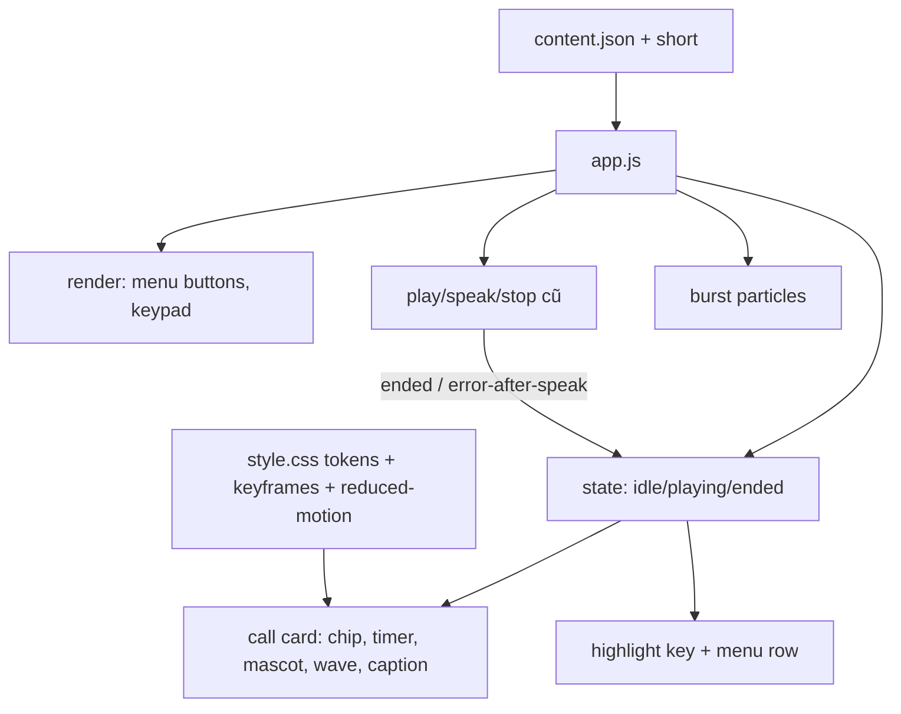

# Design Document

## Overview

Giữ nguyên kiến trúc web tĩnh 3 file và chỉ thay lớp trình bày. `app.js` có thêm 3 thứ:
- một state machine nhỏ (`idle → playing → ended`) để điều khiển thẻ cuộc gọi
- đồng hồ dùng `requestAnimationFrame`
- hiệu ứng burst

Phần dữ liệu, phát audio và dự phòng vẫn dùng các hàm cũ: `pick`, `play`, `speak`, `stop`.

**Phong cách đã chốt (2026-11-20).** User yêu cầu giao diện "không giống AI, tự nhiên như người làm, chép style nào cũng được". Tôi chép theo 2 nguồn:
- trang web neo-brutalist của Gumroad: viền mực 2px, bóng đổ cứng `4px 4px 0` không blur, màu phẳng
- zine in risograph 2 màu do trẻ em vẽ: giấy có hạt (SVG noise), nét vẽ tay rung bằng filter `#rough`, ghi chú viết tay "bấm thử đi!", sticker QR dán băng keo, highlight bằng vệt bút dạ

Không dùng gradient, glow, blur, emoji, ảnh người hay font tải ngoài.

Bảng màu (2 màu mực, xanh dương là chủ đạo):

| Vai trò | Màu |
|---|---|
| Xanh key visual, xanh nhạt (user yêu cầu 2026-11-20). Chữ đặt trên màu này luôn là mực đen | `#60A5FA` |
| Xanh dùng làm chữ hoặc link trên nền giấy (`--blue-ink`) | `#1F4FD8` (dark mode: `#8FB0FF`) |
| Vàng hướng dương | `#FFD23F` |
| Mực đen | `#111` |
| Giấy | `#F6F1E7` |
| Hồng má (điểm nhấn nhỏ) | `#F4A3B4` |

Chế độ tối: giấy `#14161B`, bóng đổ `#5A6070` (nếu dùng đen thì bóng không còn thấy được).

Font chỉ dùng của hệ thống:
- `Arial Black` / `Segoe UI Black` cho tiêu đề
- monospace cho nhãn nhỏ
- `Segoe Print` / `Bradley Hand` cho chữ viết tay

Màn hình Stitch thứ 2, bản prompt neo-brutalist, không trả về qua API. Phần code làm theo đúng bộ tiêu chí đã gửi cho Stitch.

PWA gồm các file:
- `web/manifest.webmanifest`
- `web/sw.js`: network-first, khi cài thì lưu sẵn giao diện và mp3 đọc từ `content.json`
- `web/icons/*.png`: render từ `tools/icon.svg` bằng Chromium chạy ẩn

QR gồm `tools/make_qr.py` (thư viện `qrcode` cài trong `.venv`), tạo ra `web/qr.svg`, và trang in `web/poster.html`.

**Danh sách animation (đủ cả chi tiết nhỏ):**
- Lúc tải trang:
  - header trượt xuống
  - thẻ cuộc gọi phóng to dần
  - phím hiện lần lượt
  - dòng danh mục trượt vào lần lượt
- Mascot:
  - lúc chờ: nhún nhẹ, nháy mắt định kỳ, tia nắng xoay chậm
  - lúc phát: miệng "nói", 2 vòng sáng lan ra lệch nhịp
  - lúc kết thúc: gật đầu
- Chip trạng thái:
  - chấm tròn đập theo nhịp khi đang phát
  - màu chuyển mượt khi đổi trạng thái
  - biểu tượng ✓ bật ra khi kết thúc
- Sóng âm: 7 thanh, mỗi thanh có nhịp và độ trễ riêng; khi dừng thì hạ xuống mượt.
- Phụ đề: hiện dần và trượt lên; câu dài thì tự thu nhỏ chữ.
- Phím:
  - lún xuống khi bấm, bật lên lại kiểu lò xo
  - gợn sóng (ripple) từ đúng điểm chạm
  - tim và sao bung ra
  - phím đang phát có vòng sáng nhấp nháy
  - phím rỗng lắc ngang báo "không có"
  - gõ phím trên bàn phím máy tính cũng có hiệu ứng lún
- Nút Gọi:
  - lúc chờ có vòng sáng "thở" mời bấm
  - icon điện thoại lắc khi rê chuột
  - lún xuống khi bấm
- Nút Kết thúc:
  - mờ khi đang chờ, sáng lên khi đang phát
  - icon xoay khi rê chuột
- Danh mục:
  - rê chuột thì dòng nhấc lên
  - dòng đang phát đổi màu mượt
  - nhãn "Đang phát" bật ra, có mini equalizer
- Doodle nền: trôi và xoay chậm, sao lấp lánh.
- Tim trong khối giúp đỡ đập nhẹ.
- Nút cài app trượt lên khi xuất hiện.
- Viền focus hiện ra mượt.
- Thẻ QR: hiện dần khi tải trang; rê chuột thì nghiêng nhẹ.

Font dùng system stack (`ui-rounded`, `"Segoe UI"`, `system-ui`), không tải font ngoài. Mascot và doodle là SVG inline.

## Architecture

## Components

### Component 1: content.json
- Thêm `short` cho các phím 0–7.
- **Maps to**: Req 1.2

### Component 2: index.html
- **Header**: mascot SVG, `#brand`, chip, tagline.
- **Thẻ cuộc gọi `#call-card`**: `#timer`, `#status`, mascot, `#screen` (`aria-live`), `#wave` (7 thanh).
- **Bàn phím**: `#keypad`, cùng `#call` và `#end`.
- **Danh mục**: `#menu`, mỗi mục là `<li><button>`.
- **Khối giúp đỡ** và **footer**.
- **Nền**: `
` chứa các SVG.
- **Maps to**: Req 1, 3.2, 5.2

### Component 3: style.css
- **Tokens** khai báo trong `:root`, có bản cho chế độ tối.
- **Khung điện thoại**: `@media (min-width: 768px)`.
- **Keyframes**:
  - `press` (lún phím)
  - `rise` (phụ đề hiện lên)
  - `bar` (sóng âm)
  - `ring` (vòng sáng mascot)
  - `float` (doodle trôi)
  - `pop` (burst)
- Toàn bộ chuyển động nằm trong `@media (prefers-reduced-motion: no-preference)`, nên tắt reduced motion là tắt hết.
- **Trạng thái** gắn qua `data-state` trên `<body>` và class `.active` trên phím hoặc dòng.
- **Maps to**: Req 1, 4, 5.2–5.5

### Component 4: app.js
- `setState(state, info)`: cập nhật `body.dataset.state`, chip trạng thái, highlight, và bật hoặc tắt đồng hồ.
- `play()`: gắn `audio.onended` để chuyển sang `ended`. Với TTS, `utterance.onend` cũng chuyển sang `ended`.
- `#end`: gọi `stop()` rồi chuyển sang `ended`.
- `burst(btn)`: tạo 6 phần tử con `span` (tim hoặc sao), tự xoá khi `animationend`. Bỏ qua khi bật reduced motion.
- `#screen`: mỗi lần đổi nội dung thì gỡ rồi gắn lại class `rise` để chạy lại animation.
- **Maps to**: Req 2, 3.1, 4.2–4.3

## Error Handling

| Tình huống | Xử lý |
|---|---|
| mp3 lỗi | Gọi `speak()` như cũ. Trạng thái vẫn là `playing`, chuyển sang `ended` khi TTS đọc xong |
| Không có `speechSynthesis` | Chỉ hiện phụ đề, sau 3 giây chuyển sang `ended` |
| Bấm phím rỗng | Gọi `stop()`, trạng thái `idle`, hiện câu nhắc |

## Testing Strategy

`tools/smoke.mjs` giữ toàn bộ kiểm tra cũ, chỉ cập nhật selector. Thêm các kiểm tra mới:
- đồng hồ chạy khi đang phát
- bấm `#end` thì dừng audio và trạng thái chuyển sang `ended`
- bấm dòng danh mục thì phát đúng phím
- chip hiện đúng label
- khi giả lập reduced motion thì thanh sóng âm không có animation
- tổng dung lượng file < 60KB

Ngoài ra chụp ảnh ở 360px (sáng và tối) và 1280px, rồi so bằng mắt với ảnh Stitch.
