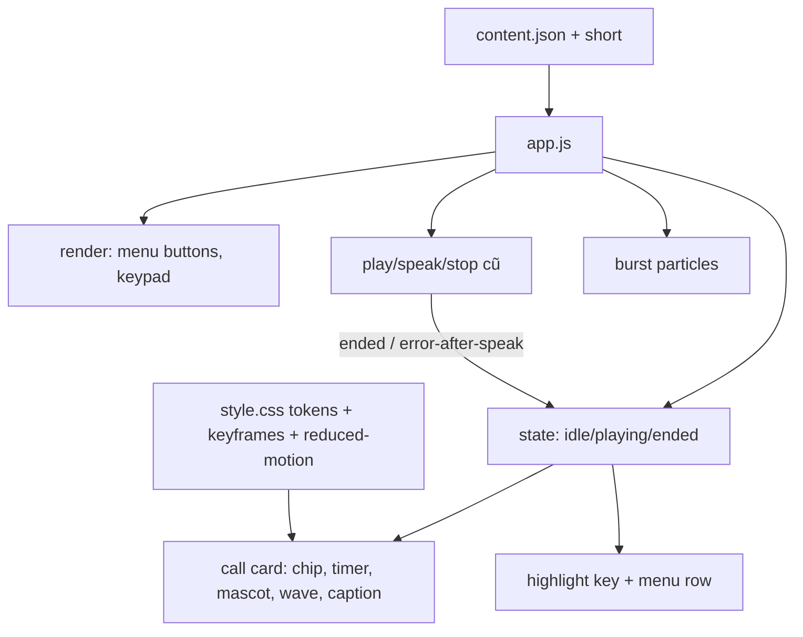

# Design Document

## Overview

Giữ nguyên kiến trúc web tĩnh 3 file và chỉ thay lớp trình bày. `app.js` có thêm 3 thứ:
- một state machine nhỏ (`idle → playing → ended`) để điều khiển thẻ cuộc gọi
- đồng hồ dùng `requestAnimationFrame`
- hiệu ứng burst

Phần dữ liệu, phát audio và dự phòng vẫn dùng các hàm cũ: `pick`, `play`, `speak`, `stop`.

Màu và hình khối lấy từ design system Stitch:
- primary `#E0457B`, secondary `#F7B731`, tertiary `#10B981`, neutral `#2D1537`, nền `#FFF9F2`
- bo góc pill, phím có bóng "kẹo" đổ xuống

Font dùng system stack (`ui-rounded`, `"Segoe UI"`, `system-ui`), không tải font ngoài. Mascot và doodle là SVG inline.

## Architecture

## Components

### Component 1: content.json
- Thêm `short` cho các phím 0–7.
- **Maps to**: Req 1.2

### Component 2: index.html
- **Header**: mascot SVG, `#brand`, chip, tagline.
- **Thẻ cuộc gọi `#call-card`**: `#timer`, `#status`, mascot, `#screen` (`aria-live`), `#wave` (7 thanh).
- **Bàn phím**: `#keypad`, cùng `#call` và `#end`.
- **Danh mục**: `#menu`, mỗi mục là `<li><button>`.
- **Khối giúp đỡ** và **footer**.
- **Nền**: `
` chứa các SVG.
- **Maps to**: Req 1, 3.2, 5.2

### Component 3: style.css
- **Tokens** khai báo trong `:root`, có bản cho chế độ tối.
- **Khung điện thoại**: `@media (min-width: 768px)`.
- **Keyframes**:
  - `press` (lún phím)
  - `rise` (phụ đề hiện lên)
  - `bar` (sóng âm)
  - `ring` (vòng sáng mascot)
  - `float` (doodle trôi)
  - `pop` (burst)
- Toàn bộ chuyển động nằm trong `@media (prefers-reduced-motion: no-preference)`, nên tắt reduced motion là tắt hết.
- **Trạng thái** gắn qua `data-state` trên `<body>` và class `.active` trên phím hoặc dòng.
- **Maps to**: Req 1, 4, 5.2–5.5

### Component 4: app.js
- `setState(state, info)`: cập nhật `body.dataset.state`, chip trạng thái, highlight, và bật hoặc tắt đồng hồ.
- `play()`: gắn `audio.onended` để chuyển sang `ended`. Với TTS, `utterance.onend` cũng chuyển sang `ended`.
- `#end`: gọi `stop()` rồi chuyển sang `ended`.
- `burst(btn)`: tạo 6 phần tử con `span` (tim hoặc sao), tự xoá khi `animationend`. Bỏ qua khi bật reduced motion.
- `#screen`: mỗi lần đổi nội dung thì gỡ rồi gắn lại class `rise` để chạy lại animation.
- **Maps to**: Req 2, 3.1, 4.2–4.3

## Error Handling

| Tình huống | Xử lý |
|---|---|
| mp3 lỗi | Gọi `speak()` như cũ. Trạng thái vẫn là `playing`, chuyển sang `ended` khi TTS đọc xong |
| Không có `speechSynthesis` | Chỉ hiện phụ đề, sau 3 giây chuyển sang `ended` |
| Bấm phím rỗng | Gọi `stop()`, trạng thái `idle`, hiện câu nhắc |

## Testing Strategy

`tools/smoke.mjs` giữ toàn bộ kiểm tra cũ, chỉ cập nhật selector. Thêm các kiểm tra mới:
- đồng hồ chạy khi đang phát
- bấm `#end` thì dừng audio và trạng thái chuyển sang `ended`
- bấm dòng danh mục thì phát đúng phím
- chip hiện đúng label
- khi giả lập reduced motion thì thanh sóng âm không có animation
- tổng dung lượng file < 60KB

Ngoài ra chụp ảnh ở 360px (sáng và tối) và 1280px, rồi so bằng mắt với ảnh Stitch.
