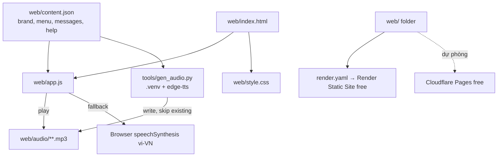
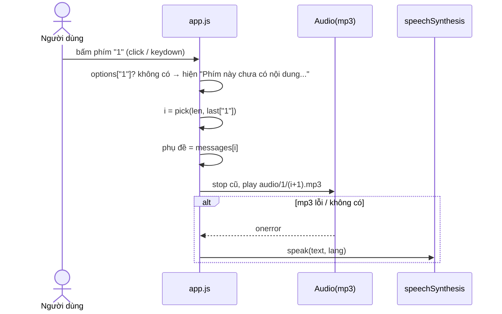

# Design Document

## Overview

Site tĩnh gồm 3 file web (`index.html`, `style.css`, `app.js`) và 1 file dữ liệu `content.json`. Không có framework, không có bước build. Khi trang tải, `app.js` đọc `content.json`, sau đó vẽ tên, menu, bàn phím và khối khẩn cấp. Khi người dùng bấm phím, trang phát `audio/<phím>/<n>.mp3`. Nếu thiếu file, trang dùng `speechSynthesis` của trình duyệt. Nếu trình duyệt cũng không đọc được, trang chỉ hiện phụ đề (Req 1, 2, 3).

Toàn bộ mp3 được tạo trước, offline, bằng `tools/gen_audio.py` chạy trong `.venv` với edge-tts (Req 4). Web không gọi dịch vụ ngoài nào. Thay giọng thật chỉ cần chép đè mp3 cùng tên, vì script bỏ qua file đã có (Req 3.4, 4.3).

Thư mục deploy duy nhất là `web/`. Đẩy lên GitHub Pages hoặc Cloudflare Pages là chạy, chi phí 0đ (Req 7).

## Architecture



## Components

### Component 1: content.json
- **Responsibility**: Nơi duy nhất chứa tên hiển thị, menu, lời nhắn và số khẩn cấp.
- **Inputs**: nhóm dự án sửa tay.
- **Outputs**: JSON, được `app.js` và `gen_audio.py` đọc.
- **Maps to**: Req 2.1, 2.2, 2.5, 5.1, 5.4, 5.5
- **File**: `web/content.json`

### Component 2: index.html + style.css
- **Responsibility**: Khung trang và giao diện. Các vùng chính:
  - header (tên)
  - menu
  - màn hình phụ đề `aria-live`
  - bàn phím 3×4 và nút "Gọi"
  - khối "Cần giúp đỡ ngay?"
  - footer (ghi nguồn Peptoc, ghi chú demo)
- **Inputs**: Không có.
- **Outputs**: DOM có các id cố định: `brand`, `menu`, `screen`, `keypad`, `call`, `help`.
- **Maps to**: Req 1.1, 1.2, 2.4, 5.1–5.3, 6.1–6.4
- **File**: `web/index.html`, `web/style.css`
- **Ghi chú**: dùng CSS variables. Chế độ tối dùng `@media (prefers-color-scheme: dark)`. Mỗi phím có kích thước tối thiểu `min-height: 56px`. Không dùng font hay script ngoài (Req 7.2).

### Component 3: app.js
- **Responsibility**: Nạp dữ liệu, vẽ UI, xử lý phím, phát audio có dự phòng.
- **Inputs**: `content.json`, sự kiện click, sự kiện `keydown` (0–9).
- **Outputs**: phát âm thanh và hiện phụ đề.
- **Maps to**: Req 1.3–1.6, 2.3, 2.4, 3.1–3.3, 5.4
- **File**: `web/app.js`
- **Hàm chính**:
  - `init()`: fetch content, render
  - `press(key)`: xử lý một phím
  - `pick(n, last)`: chọn ngẫu nhiên, không lặp lại câu vừa phát
  - `play(src, text, lang)`: dừng audio cũ, phát `Audio(src)`. Nếu `onerror` thì chuyển sang `speak(text, lang)`
  - `speak(text, lang)`: dùng `speechSynthesis`. Nếu trình duyệt không có thì bỏ qua (vẫn có phụ đề)

### Component 4: gen_audio.py
- **Responsibility**: Tạo mp3 cho lời chào và mọi lời nhắn.
- **Inputs**: `web/content.json`, cờ `--force`.
- **Outputs**:
  - file `web/audio/greeting.mp3` và `web/audio/<key>/<i>.mp3`
  - danh sách lỗi và exit code
- **Maps to**: Req 4.1–4.5
- **File**: `tools/gen_audio.py`
- **Ghi chú**: dùng `edge_tts.Communicate(text, voice).save(path)`. Giọng lấy từ `option.voice`, nếu không có thì lấy `content.voice`. Mỗi câu chạy trong `try` riêng.

### Component 5: README.md
- **Responsibility**: Hướng dẫn chạy local, tạo audio, thay giọng thật, deploy free, giới hạn và chi phí.
- **Maps to**: Req 7.4, 7.6
- **File**: `README.md`

### Component 6: render.yaml
- **Responsibility**: Blueprint deploy `web/` thành Render Static Site (gói Hobby free, không ngủ, có CDN và SSL).
- **Maps to**: Req 7.1, 7.5
- **File**: `render.yaml`
- **Ghi chú**: `type: web`, `runtime: static`, `staticPublishPath: ./web`, build command rỗng (`echo no build`). Render cần repo GitHub/GitLab. User tự tạo repo và đăng nhập Render, agent không làm thay bước cần tài khoản.
- **Giới hạn**: gói Hobby có khoảng 5GB băng thông/tháng, dùng chung cả workspace. Vượt thì khoảng $0.15/GB. Toàn bộ audio ước 1–2MB, tức khoảng 5.000 lượt nghe đầy đủ trở lên mỗi tháng. Nếu vượt mức, chuyển sang Cloudflare Pages (băng thông không giới hạn, free) với cùng thư mục `web/`.

## Data Models

```jsonc
// web/content.json
{
  "brand": "Đường Dây Vui Vẻ",            // Req 5.5 — đổi tên ở đây
  "note": "Câu demo phỏng theo Peptoc (peptoc.org). Thay câu hoặc xin phép trước khi công khai.",
  "voice": "vi-VN-HoaiMyNeural",           // giọng mặc định cho gen_audio
  "greeting": "Xin chào! Bạn đã gọi tới ... Bấm 1 nếu ...",
  "options": {
    "1": { "label": "Nếu bạn đang bực bội, nản lòng hay lo lắng", "messages": ["...", "...", "..."] },
    "5": { "label": "Lời cổ vũ bằng tiếng Anh", "voice": "en-US-AnaNeural", "lang": "en-US", "messages": ["..."] },
    "0": { "label": "Ủng hộ dự án", "messages": ["Cảm ơn bạn ..."], "info": "Thông tin ủng hộ: đang cập nhật." }
  },
  "help": [
    { "name": "Tổng đài quốc gia bảo vệ trẻ em", "phone": "111" },
    { "name": "Cấp cứu", "phone": "115" } // chỉ số công cộng; số tổ chức tư nhân cần xin phép
  ]
}
```

Quy ước đường dẫn audio:
- Lời chào: `audio/greeting.mp3`
- Lời nhắn: `audio/<key>/<index+1>.mp3`

Mapping giữa câu và file theo **thứ tự** trong mảng. Vì vậy khi chèn câu mới vào giữa mảng, phải chạy lại `--force` hoặc đổi tên file cho khớp. Hạn chế này được ghi trong README.

## Sequence Diagrams



## Error Handling

| Lỗi | Xử lý | Req |
|---|---|---|
| Phím không có trong `options` | Hiện "Phím này chưa có nội dung, mời bạn chọn phím khác" | 1.6 |
| mp3 404 hoặc không giải mã được | `onerror` → `speak()` + phụ đề | 3.2 |
| Không có `speechSynthesis` | Chỉ hiện phụ đề | 3.3 |
| `content.json` không tải được (vd. mở bằng file://) | Hiện "Không tải được nội dung — hãy chạy qua http server" | — |
| Trình duyệt chặn autoplay | Audio chỉ phát sau thao tác click hoặc phím, là cử chỉ của người dùng nên được phép | 1.3 |
| edge-tts lỗi một câu | In ra câu lỗi, chạy tiếp, exit 1 | 4.4 |

## Testing Strategy

- **gen_audio.py**:
  - chạy `--dry-run` để in danh sách file sẽ tạo hoặc bỏ qua, không gọi mạng
  - một self-check bằng `assert` cho hàm tạo đường dẫn
  - chạy thật một lần, đếm số file mp3 bằng số câu + 1
- **app.js** (tự kiểm trong browser, chạy qua `http.server`):
  - bấm từng phím 0–7 → có tiếng và phụ đề
  - bấm 8, 9, *, # → hiện thông báo
  - bấm cùng một phím hai lần → không lặp câu
  - xóa tạm 1 mp3 → trình duyệt đọc thay
  - gõ phím số trên bàn phím máy tính → hoạt động
  - đo ở chiều rộng 360px → không cuộn ngang
  - bật dark mode → hiển thị đúng
- **Dung lượng**: kiểm tra tổng `web/` < 50MB.
- Không thêm framework test. Logic JS đủ nhỏ để kiểm bằng checklist trên trình duyệt.
