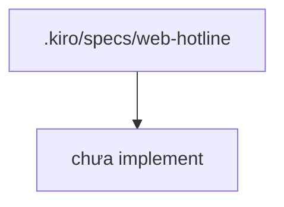

# Codebase graph + tiến độ (đọc file NÀY thay vì đọc lại toàn bộ code)

> Quy tắc: agent đọc file này để hiểu codebase. Chỉ mở file code khi cần SỬA nó.
> Sau mỗi task hoàn thành, agent PHẢI cập nhật: (1) graph, (2) bảng file, (3) nhật ký tiến độ.

## 1. Graph phụ thuộc

## 2. Bảng file

| File | Vai trò | Symbol chính | Phụ thuộc |
|---|---|---|---|
| _(chưa có)_ | | | |

## 3. Trạng thái hiện tại
- Spec đang làm: `web-hotline`
- Phase: tasks (chờ user duyệt) — 0/11 task (đếm task lá + checkpoint)
- Task kế tiếp: 1.1 Tạo `.venv` và cài edge-tts

## 4. Nhật ký tiến độ (mới nhất ở trên)
- 2026-11-19 — Commit đầu tiên + repo public https://github.com/Rod-HD/duong-day-vui-ve (branch `main`, email commit = GitHub noreply, chỉ cấu hình local repo này). Backup: `git clone` repo này.
- 2026-11-19 — Sau khi cài lại Windows: đối chiếu với lịch sử chat → đủ 9 file, nội dung khớp, chưa có code nên không mất gì. Chưa có repo GitHub. Sửa đường dẫn Python trong environment.md.
- 2026-11-17 — design duyệt + thêm deploy Render (render.yaml, Req 7.5–7.6; Render Hobby chỉ 5GB/tháng → Cloudflare Pages dự phòng). Viết tasks.md + .config.kiro.
- 2026-11-17 — requirements.md được duyệt (phím 5 = tiếng Anh; số Ngày Mai 0963061414 cần gọi thử trước khi public). Viết design.md.
- 2026-11-17 — Bootstrap Kiro: environment.md, AGENTS.md, CLAUDE.md, requirements.md.
