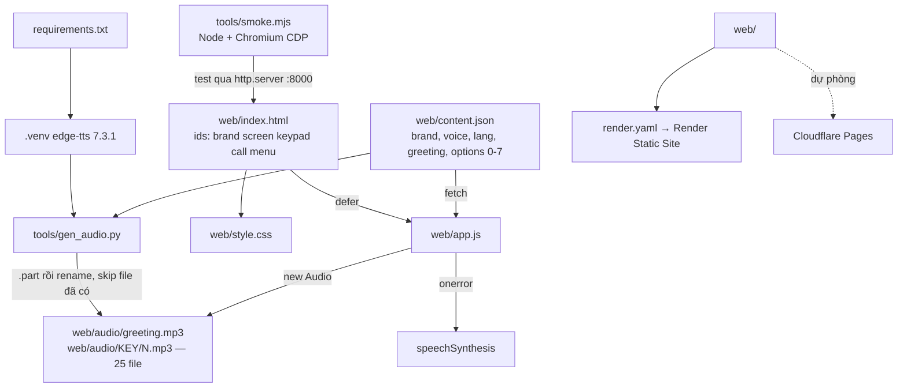

# Codebase graph + tiến độ (đọc file NÀY thay vì đọc lại toàn bộ code)

> Quy tắc: agent đọc file này để hiểu codebase. Chỉ mở file code khi cần SỬA nó.
> Sau mỗi task hoàn thành, agent PHẢI cập nhật: (1) graph, (2) bảng file, (3) nhật ký tiến độ.

## 1. Graph phụ thuộc

## 2. Bảng file

| File | Vai trò | Symbol chính | Phụ thuộc |
|---|---|---|---|
| `web/content.json` | Nguồn DUY NHẤT: tên (`brand`), menu, 24 câu (KHÔNG có số điện thoại) | `options[key].{label,messages,voice?,lang?,info?}`, `{brand}` placeholder | — |
| `web/index.html` | Khung trang, footer ghi nguồn Peptoc + ghi chú demo, khối "Cần giúp đỡ ngay?" (chữ tĩnh, không số) | id `brand screen(aria-live) keypad call menu` | style.css, app.js |
| `web/style.css` | CSS variables, dark mode, phím ≥56px, max-width 420px | `:root` tokens | — |
| `web/app.js` | Nạp JSON, vẽ UI, phím click + keydown, phát mp3 → TTS → phụ đề | `init render press pick play speak stop fill`; global `audio`, `last` | content.json, audio/ |
| `web/audio/` | 25 mp3 TTS (≈824KB). Thay giọng thật = chép đè cùng tên | `greeting.mp3`, `<key>/<index+1>.mp3` | gen_audio.py |
| `tools/gen_audio.py` | Tạo mp3 thiếu; `--force` ghi đè, `--dry-run` | `jobs() timeout_for() _selfcheck()`, RETRIES=5 | content.json, edge-tts |
| `tools/smoke.mjs` | 24 kiểm tra tự động (render, phím, mp3 chạy, không lặp, fallback TTS, 360px, dark, không lỗi console) | `check()`; Chrome port 0 + taskkill /T | Chromium `D:\Programs\ms-playwright\chromium-1148`, server :8000 |
| `render.yaml` | Blueprint Render Static Site, publish `./web` | service `duong-day-vui-ve` | web/ |
| `README.md` | Hướng dẫn chạy, sửa câu, thay giọng, đổi tên, deploy, giới hạn + giá | — | — |
| `requirements.txt` | Thư viện Python | `edge-tts==7.3.1` | — |
| `.venv/` (gitignored) | Python 3.13.1 của project | — | requirements.txt |

## 3. Trạng thái hiện tại
- Spec đang làm: `web-hotline`
- Phase: XONG — 11/11 task. Demo live: https://duong-day-vui-ve.onrender.com (Render Static Site free, Blueprint `duong-day-vui-ve`, auto-deploy khi push `main`).
- Việc mở cho sau (chưa có spec): thay câu nói thật / xin phép Peptoc, thu âm giọng trẻ em (đặc biệt phím 4), tên chính thức, số tổng đài thật (có phí).

## 4. Nhật ký tiến độ (mới nhất ở trên)
- 2026-11-20 — Task 5.3 + 6 xong: agent tạo Blueprint trên Render qua Chrome (user tự đăng nhập). Live commit 65b57eb, smoke.mjs trên link thật 24/24 PASS.
- 2026-11-20 — Theo yêu cầu user: xoá luôn 111 và 115 → trang KHÔNG có số điện thoại nào. Bỏ `help` khỏi content.json, app.js, index.html; Req 5.1 đổi thành "SHALL NOT hiển thị số"; smoke test kiểm không có `tel:`.
- 2026-11-20 — Theo yêu cầu user: GỠ số Ngày Mai (số của tổ chức khác, chưa xin phép). Khối help chỉ còn 111, 115. Sửa Req 5.1, design, tasks, README, smoke test.
- 2026-11-19 — Task 5.1 + 5.2 xong: render.yaml, README (chạy, test, sửa câu, giọng thật, đổi tên, deploy Render/Cloudflare, bảng giới hạn + giá). web/ = 835KB (< 50MB). Đã push GitHub.
- 2026-11-19 — Task 3 + 4 xong: index.html/style.css/app.js; smoke test 24/24 PASS (ổn định 3 lần), xem ảnh 360px sáng/tối OK. Thêm `tools/smoke.mjs`.
- 2026-11-19 — Task 2 xong: 25 mp3 (824KB), chạy lại = skip 25. edge-tts free hay treo ngẫu nhiên → thêm timeout theo độ dài câu + 5 lần retry + ghi file tạm `.part`.
- 2026-11-19 — Task 1.2 xong: `web/content.json` (24 câu: phím 1–7 có 3–4 câu, phím 0 có 1 câu; `{brand}` là placeholder; 3 số help). Đã kiểm JSON + số câu.
- 2026-11-19 — Task 1.1 xong: `.venv` (Python 3.13.1) + edge-tts 7.3.1, kiểm `import edge_tts` OK. Thêm requirements.txt.
- 2026-11-19 — Commit đầu tiên + repo public https://github.com/Rod-HD/duong-day-vui-ve (branch `main`, email commit = GitHub noreply, chỉ cấu hình local repo này). Backup: `git clone` repo này.
- 2026-11-19 — Sau khi cài lại Windows: đối chiếu với lịch sử chat → đủ 9 file, nội dung khớp, chưa có code nên không mất gì. Sửa đường dẫn Python trong environment.md.
- 2026-11-17 — design duyệt + thêm deploy Render (render.yaml, Req 7.5–7.6; Render Hobby chỉ 5GB/tháng → Cloudflare Pages dự phòng). Viết tasks.md + .config.kiro.
- 2026-11-17 — requirements.md được duyệt (phím 5 = tiếng Anh; số Ngày Mai 0963061414 cần gọi thử trước khi public). Viết design.md.
- 2026-11-17 — Bootstrap Kiro: environment.md, AGENTS.md, CLAUDE.md, requirements.md.
