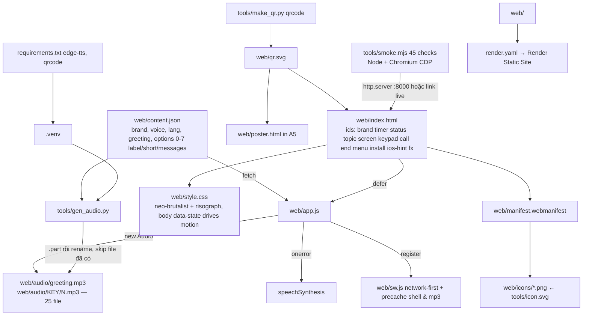

# Codebase graph + tiến độ (đọc file NÀY thay vì đọc lại toàn bộ code)

> Quy tắc: agent đọc file này để hiểu codebase. Chỉ mở file code khi cần SỬA nó.
> Sau mỗi task hoàn thành, agent PHẢI cập nhật: (1) graph, (2) bảng file, (3) nhật ký tiến độ.

## 1. Graph phụ thuộc

## 2. Bảng file

| File | Vai trò | Symbol chính | Phụ thuộc |
|---|---|---|---|
| `web/content.json` | Nguồn DUY NHẤT: tên, menu, 24 câu, nhãn ngắn phím (KHÔNG có số điện thoại) | `options[key].{label,short,messages,voice?,lang?,info?}`, `{brand}` | — |
| `web/index.html` | Khung trang: masthead, thẻ cuộc gọi (mascot SVG), bàn phím, nút Gọi/Kết thúc, danh mục, sticker QR (desktop), nút cài app, khối giúp đỡ (không số), footer | filter SVG `#rough`, `.doodles`, `.grain`, `#fx` | style.css, app.js, qr.svg, manifest |
| `web/style.css` | Tokens xanh cobalt/vàng/mực/giấy, dark mode, khung điện thoại ≥900px; TOÀN BỘ animation trong `@media (prefers-reduced-motion: no-preference)`; entrance chỉ chạy khi `body:not(.ready)` | `body[data-state=idle/playing/ended]`, `.active`, `.pressed`, `.nope`, `.rise`, `.flip`, `.particle`, `.ripple` | — |
| `web/app.js` | State machine cuộc gọi + đồng hồ rAF; phát mp3 → TTS → phụ đề; burst/ripple (dọn bằng timer); PWA install + đăng ký SW | `init setupApp render press play speak stop setState setStatus say pick burst ripple flash restart`; global `audio`, `playId` | content.json, audio/, sw.js |
| `web/sw.js` | Offline: network-first, cache fallback; precache shell + mp3 đọc từ content.json; bỏ qua 206 | `CACHE="ddvv-v1"` (tăng khi đổi SHELL) | content.json |
| `web/manifest.webmanifest` | PWA standalone, theme `#1F4FD8` | icons 192/512 (+maskable) | icons/ |
| `web/icons/` | icon-192, icon-512, apple-touch-icon (render từ tools/icon.svg) | — | tools/icon.svg |
| `web/qr.svg`, `web/poster.html` | QR tới link demo; trang in A5 | — | tools/make_qr.py |
| `web/audio/` | 25 mp3 TTS (≈824KB). Thay giọng thật = chép đè cùng tên | `greeting.mp3`, `<key>/<index+1>.mp3` | gen_audio.py |
| `tools/gen_audio.py` | Tạo mp3 thiếu; `--force`, `--dry-run`; retry 5 lần | `jobs() timeout_for() _selfcheck()` | content.json, edge-tts |
| `tools/make_qr.py` | Tạo web/qr.svg (ECC H) | `URL` (argv[1]) | qrcode 8.2 |
| `tools/smoke.mjs` | 45 kiểm tra (render, phím, state/timer, end, menu click, không lặp, fallback TTS, motion bật/tắt, PWA, QR, size, dark, desktop) | `check() waitFor() MOTION_OK` | Chromium `D:\Programs\ms-playwright\chromium-1148`, server |
| `render.yaml` | Blueprint Render Static Site, publish `./web` | service `duong-day-vui-ve` | web/ |
| `README.md` | Hướng dẫn chạy, test, QR/PWA, sửa câu, giọng thật, deploy, giới hạn + giá | — | — |
| `requirements.txt` | Thư viện Python | `edge-tts==7.3.1`, `qrcode==8.2` | — |

## 3. Trạng thái hiện tại
- Spec `web-hotline`: XONG 11/11. Demo live: https://duong-day-vui-ve.onrender.com (auto-deploy khi push `main`).
- Spec `ui-refresh`: XONG 9/9. Live 45/45 PASS (commit 0e4a26a).
- Việc mở cho sau: thay câu nói thật / xin phép Peptoc, thu âm giọng trẻ em (đặc biệt phím 4), tên chính thức, chatbot Messenger (0đ) nếu cần kênh nhắn tin, số tổng đài thật (có phí).

## 4. Nhật ký tiến độ (mới nhất ở trên)
- 2026-11-20 — Key visual đổi sang xanh nhạt `--blue: #60A5FA` (theme-color, manifest, icon, poster). Chữ trên nền xanh = mực `#111` (`.call > *` ép `--ink/--card` cố định cho cả dark mode); chữ/link xanh trên giấy dùng `--blue-ink` `#1F4FD8`/`#8FB0FF`. Tia nắng mascot + icon đổi sang mực. SW cache → `ddvv-v2`. Smoke 45/45.
- 2026-11-20 — ui-refresh task 5 xong: Render tự deploy 0e4a26a, smoke.mjs trên link live 45/45 PASS.
- 2026-11-20 — ui-refresh task 1–4 xong: user đổi màu chủ đạo xanh dương + yêu cầu UI "như người làm" → phong cách neo-brutalist (Gumroad) × risograph zine; PWA (manifest, sw, icons), QR + poster; smoke 45/45 ×3. Lỗi tìm được nhờ test: hạt burst kẹt khi tắt motion giữa chừng → dọn bằng timer. Windows máy này bật reduced-motion → smoke ép `no-preference`.- 2026-11-20 — Spec mới `ui-refresh` (CHỜ USER DUYỆT): thiết kế Stitch project 13630802284968747190 (ảnh: `.kiro/specs/ui-refresh/stitch-mockup.png`). Bỏ khỏi bản code: ảnh trẻ em thật, tên "Bé An" bịa, tab giả, Google Fonts.
- 2026-11-20 — Task 5.3 + 6 xong: agent tạo Blueprint trên Render qua Chrome (user tự đăng nhập). Live commit 65b57eb, smoke.mjs trên link thật 24/24 PASS.
- 2026-11-20 — Theo yêu cầu user: xoá luôn 111 và 115 → trang KHÔNG có số điện thoại nào. Bỏ `help` khỏi content.json, app.js, index.html; Req 5.1 đổi thành "SHALL NOT hiển thị số"; smoke test kiểm không có `tel:`.
- 2026-11-20 — Theo yêu cầu user: GỠ số Ngày Mai (số của tổ chức khác, chưa xin phép). Khối help chỉ còn 111, 115. Sửa Req 5.1, design, tasks, README, smoke test.
- 2026-11-19 — Task 5.1 + 5.2 xong: render.yaml, README (chạy, test, sửa câu, giọng thật, đổi tên, deploy Render/Cloudflare, bảng giới hạn + giá). web/ = 835KB (< 50MB). Đã push GitHub.
- 2026-11-19 — Task 3 + 4 xong: index.html/style.css/app.js; smoke test 24/24 PASS (ổn định 3 lần), xem ảnh 360px sáng/tối OK. Thêm `tools/smoke.mjs`.
- 2026-11-19 — Task 2 xong: 25 mp3 (824KB), chạy lại = skip 25. edge-tts free hay treo ngẫu nhiên → thêm timeout theo độ dài câu + 5 lần retry + ghi file tạm `.part`.
- 2026-11-19 — Task 1.2 xong: `web/content.json` (24 câu: phím 1–7 có 3–4 câu, phím 0 có 1 câu; `{brand}` là placeholder; 3 số help). Đã kiểm JSON + số câu.
- 2026-11-19 — Task 1.1 xong: `.venv` (Python 3.13.1) + edge-tts 7.3.1, kiểm `import edge_tts` OK. Thêm requirements.txt.
- 2026-11-19 — Commit đầu tiên + repo public https://github.com/Rod-HD/duong-day-vui-ve (branch `main`, email commit = GitHub noreply, chỉ cấu hình local repo này). Backup: `git clone` repo này.
- 2026-11-19 — Sau khi cài lại Windows: đối chiếu với lịch sử chat → đủ 9 file, nội dung khớp, chưa có code nên không mất gì. Sửa đường dẫn Python trong environment.md.
- 2026-11-17 — design duyệt + thêm deploy Render (render.yaml, Req 7.5–7.6; Render Hobby chỉ 5GB/tháng → Cloudflare Pages dự phòng). Viết tasks.md + .config.kiro.
- 2026-11-17 — requirements.md được duyệt (phím 5 = tiếng Anh; số Ngày Mai 0963061414 cần gọi thử trước khi public). Viết design.md.
- 2026-11-17 — Bootstrap Kiro: environment.md, AGENTS.md, CLAUDE.md, requirements.md.
